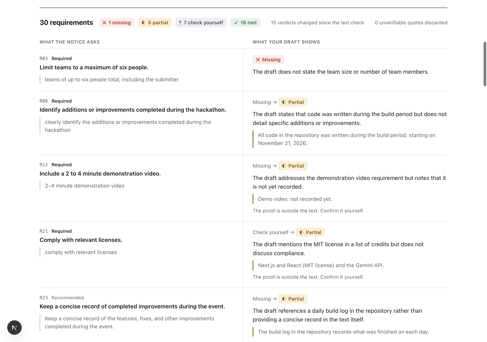

<!--
ReqLens — Devpost submission text, draft v1 (written 2026-11-26, no model call made for it).
How to use: paste each block into the matching Devpost field. HTML comments like this one are
source notes for our own checking; delete them before pasting (Devpost may print them).
Open items are marked [TODO: ...]. Every number below was re-read from the files named in the comments.
-->

# Devpost fields

**Project name:** ReqLens

**Tagline (short pitch):** Paste the rules and your draft: every requirement next to the sentence in your draft that answers it.

**Built With:** next.js, react, typescript, node.js, gemini-api, vercel
<!-- source: package.json (next, react, typescript); lib/gemini.ts (Gemini API); deployed on Vercel (README "IP_DAILY_CAP on Vercel", eval/results.md "Deployed site") -->

**Try it out links:**
- Live site: https://reqlens-two.vercel.app (press "Try a sample": no key, no account, no model call)
- Code: https://github.com/coo001/reqlens
- Test results, as generated: https://github.com/coo001/reqlens/blob/main/eval/results.md

**Video:** [TODO: YouTube link after upload]

---

# Project description ("About the project" field, paste from here)

**ReqLens checks a draft against the rules it has to follow.** You paste a notice (hackathon rules, a contest call, a scholarship posting) and your draft. It lists each requirement with the exact sentence it comes from, and next to it the sentence in your draft that answers it, or says that nothing does.

<!-- [TODO: retake] docs/screens/sample_gap_1440.png is from Nov 22 and still shows "Do not publish passwords: Missing", a wrong flag that a later code step removed. Take a fresh shot of /?sample=1 (no model call) and use it as the first image. Until then the re-check screen below is used. -->

Rubric labels (V1 … D4) are in brackets. All numbers come from [`eval/results.md`](https://github.com/coo001/reqlens/blob/main/eval/results.md), which a script generates from saved model responses and which is committed with the bad results left in.

## 1. Who is your project for, and why would they use it?

**For:** a student entering a hackathon, contest or scholarship alone, a day or two before the deadline, holding a draft and wondering what it leaves out.

**Evidence of the need [V1]**

<!-- source: eval/results.md "Organizer's own summary" (205 / 3257 words, 4 of 17); "Hard case" table (9/5/8/8 and 1/6/7/16) -->
- This challenge is our own example. Its rules and resources pages are 3,257 words. The "Getting started" section, the part most people read, is 205 words and states 4 of the 17 required items in our answer key.
- We ran our own early project description against those rules. 9 requirements came back Missing, among them disclosing existing work, the statement about mocked features and the video.
<!-- source: prep/raw/gallery/tally.tsv (104 rows; video=0 in 18, code_link=0 in 34). This file is NOT in the public repo. -->
- On the public gallery of this organizer's previous hackathon (104 projects), an automated first pass found no embedded video on 18 project pages and no code link on 34. Nobody checked this by hand or against that event's rules, so it only shows that those parts were not visible on the page.

**A realistic use [V1]:** paste this challenge's rules and a draft description, read the Missing rows, rewrite, press Re-check.

| Draft | Missing | Partial | Check yourself | Met |
|---|---|---|---|---|
| Early | 9 | 5 | 8 | 8 |
| Revised | 1 | 6 | 7 | 16 |

The revised draft was written before the first result was seen. The screen showed "15 verdicts changed since the last check" ([screenshot](https://github.com/coo001/reqlens/blob/main/docs/screens/hard1_recheck.png)).

**Compared with what people do now [V2]**

<!-- source: eval/results.md "Organizer's own summary", "Chatbot answers scored", "One-shot chatbot baseline", "Requirement extraction, by stage", "By notice" (n2 22/22, n4 11/12) -->
| Existing way | What we measured | Result |
|---|---|---|
| Read the organizer's short summary | Required items stated in that section (counted by `eval/guidance.ts`, no model) | 4 of 17 for this challenge, 10 of 17 for an essay contest. The other 3 notices have no summary section |
| Ask a chatbot once (same Gemini model, one plain question, 3 notice and draft pairs) | Required items found; quotes that are word for word in the notice; verdict on a removed paragraph | Found every required item in all 3 pairs (ReqLens: all 22 on one notice, 11 of 12 on the other). In the pair with the problem paragraph removed it answered "MET" for that requirement (ReqLens: Partial) and none of its 10 quotes was word for word in the notice. It also marked 3, 2 and 0 items as met that a draft cannot show, such as eligibility (this last count was added after we had read the answers) |
| Search for "must", "required", "should" (code, no AI) | Required items found over 5 notices | 55.4% (51/92), against 87.0% (80/92) for ReqLens |

We do not claim ReqLens finds more requirements than a chatbot: in these 3 pairs it did not. What it adds is this: every quote on screen has been checked by code to be in your text, requirements that text cannot prove are set aside instead of being judged, and a re-check marks each verdict that changed. Three pairs is a very small sample. We did not measure time saved.

**Usable with what the user has [V3]:** a browser and two pieces of text. No account, no install, no payment. The input screen says that the text is sent to Google's Gemini API.

## 2. What did your team build or improve during the hackathon?

<!-- source: git log (first commit c43da7b 2026-11-21 20:18 KST, 27 commits as of e5a39d9); README "What existed before the build period"; npm test output (20 pass, run 2026-11-26) -->
A new project. The repository started empty; the first commit is from Nov 21, 20:18 KST, after the build period opened, and there are 27 commits.

Built during the event:
- The web app (Next.js, TypeScript): three API routes, the side-by-side result screen, two recorded samples.
- Quote Lock, Counted and the "Check yourself" split (section 3).
- Record and replay of every model response, a daily call cap and a fault switch for testing failures.
- The scorer and its results file, 20 unit tests, a build log, and the scripts that recorded and cut the video.

Prepared before the build period (no code): text snapshots of 5 public notices, an answer key of 145 requirements, and 8 made-up drafts (2 complete, 6 with one planted gap). Two more gap drafts were added on Nov 22.

Third-party: Next.js, React, TypeScript, the Gemini API (free tier), Vercel hosting. The video was recorded with Playwright and cut with ffmpeg. No template or starter kit.

## 3. How did your team use AI?

### AI in the finished project

Gemini (`gemini-3.5-flash`) is called twice per check: once to list the requirements, once to compare them with the draft. Everything else is code.

| Step | Done by | What happens |
|---|---|---|
| 1. Extract requirements | Gemini | Each requirement with a quote from the notice and a level (required, recommended, scoring) |
| 2. Quote Lock | Code | A quote is kept only if it is in the notice word for word. Otherwise the item is discarded and counted |
| 3. Compare | Gemini | One verdict per requirement, with a quote from the draft as evidence |
| 4. Counted | Code | For a word limit, code counts the words and sets the verdict |
| 5. Check yourself | Code | Requirements text cannot prove (age, enrollment, deadlines) get no verdict. A prohibition or judging criterion the model calls "missing" is moved here too |

**Why this model and method [A1]**

<!-- source: eval/results.md "Lighter model, extraction only" and "By notice"; "Requirement extraction, by stage" baseline row; README "Run it locally" (free-tier key) -->
The user is a student, so the app runs on a free-tier key from one provider. Reading rules needs a language model: a marker-word rule in code found 55.4% of required items at 51.2% precision, against 87.0% and 97.3%.

| Extraction on 2 notices | Required items found | Time |
|---|---|---|
| `gemini-3.5-flash` (default) | 22 of 22, 11 of 12 | 24 s, 13 s |
| `gemini-3.5-flash-lite` | 21 of 22, 11 of 12 | 4 s, 2 s |

The lighter model was 4 to 6 times faster and missed one more required item. We kept the default because a missed requirement is the costly error here and every saved test run uses it. Two notices cannot settle this.

**Design choices and what they did [A2]**

<!-- source: eval/results.md "Requirement extraction, by stage" (1 of 112), "Comparison, by stage" (word-limit rows, planted gap shown as Met), "Planted gaps" summary lines; docs/build-log.md day 2 evening (conduct-rule step), day 4 morning (criterion step: A_complete v2 3 -> 2) -->
| Choice | Evidence |
|---|---|
| Quote Lock | 1 of 112 extracted items had a quote that is not in the notice; it was discarded before display. No evidence quote failed the check in any saved run, so the measured effect is small. What it gives is a guarantee: no unverified quote reaches the screen |
| Counted | The model is told not to count and answered "cannot tell" on the over-length essay (537 words, limit 500). With the code count, word-limit rows without a correct verdict went from 4 of 4 to 0 of 4 |
| Stricter comparison prompt (v2: the cited sentence must itself satisfy the requirement) | Planted gaps shown: 1 of 6 with v1, 4 of 6 with v2. By the model alone, before the code steps: 0 and 3 |
| Check yourself for prohibitions and judging criteria | Removed 2 wrong flags on a complete draft ("Do not publish passwords" shown as Missing; an unaddressed judging criterion) without changing any gap result |

A third prompt (v3, one quote per part of a requirement) scored 3 of 6, and 1 of 2 on gap drafts it had never been tuned on. It was slower (one call took 97 s, one hit the 100 s timeout), so the app stays on v2.

**Quality check and when to trust it [A3]**

<!-- source: eval/results.md header (145 items, 5 notices, 10 drafts, 8 planted gaps, temperature 0), stage table, "Planted gaps", "Complete drafts" (compare-v2 rows), "By notice" (n1 42.3%, n5 58.8%); build-log day 2 evening (B_gap1/B_gap2 unseen: 0 of 2) -->
Method: 5 notices, an answer key of 145 requirements (92 required), 10 drafts with 8 planted gaps, one run per input at temperature 0. `node eval/score.ts` pairs tool items with key items by overlapping quotes and only counts. It makes no model call.

| Check | Result |
|---|---|
| Required items found | 87.0% (80/92) |
| Tool items that match a key item | 97.3% (108/111) |
| Planted gaps shown as Missing or Partial, default prompt | 4 of 6. The prompt was written after seeing 4 of these 6; on the 2 it had not seen, 0 of 2 |
| Rows flagged on the 2 complete drafts, default prompt | 2 of 30 and 2 of 14, all wrong |

<!-- source: G3 plan section 4.2 fixed wording; prep/CHANGELOG.md 2026-11-19 (2 items corrected). The audit note is NOT in the public repo. -->
The answer key was written independently by two AI models from different companies (Claude and GPT) and reconciled by quote overlap. For this challenge's own rules a separate AI agent then audited the list line by line against the source and corrected 2 items; that auditor is the same model family as one of the two authors. **No human verified the answer key.** Planted gaps are the most reliable number because the answer is fixed by how the draft was made.

- **Trust:** that a quoted sentence is really in your text, and word-limit verdicts.
- **Use as a pointer:** Missing and Partial rows. Some are wrong; the row shows the sentence so you can judge.
- **Do not trust:** a Met row as proof. 2 of 6 planted gaps were shown as Met, each time because another paragraph still mentioned the topic. Coverage is also weaker for rubric lines (for this challenge 22 of the 52 key items were listed, 42.3%; most of the misses are its scoring checks) and for instructions inside an essay topic (58.8% of required items on that notice).

### AI used during development [A4]

<!-- source: docs/build-log.md "Who checked" lines (day 2, day 3), day 2 table (Counted 410..537, scorer self-check), day 2 shell mistake, day 3 v3 decision, day 4 15:00 extract-v2 decision -->
The code, prompts, tests, build log and this description were written by an AI coding agent (Claude). **No human reviewed the code.** Checks were made by code and by the same AI against values fixed in advance:

| AI output | Checked against | Found | Decision |
|---|---|---|---|
| Word-counting code | Counts printed by a separate script for 8 drafts (410 … 537) | All equal | Kept |
| Scorer | The answer key scored against itself, and an empty output | 100% and 0 | Kept |
| Comparison prompt v1 | 6 planted gaps | 1 of 6: a passing mention was accepted as Met | Revised (v2) |
| Comparison prompt v3 | The same 6 and 2 held-out drafts | 3 of 6, slower | Rejected as default |
| Extraction prompt v2 | Answer key, 2 notices | All-item recall 42.3% to 90.4%, but one more required item missed | Rejected as default, kept as a measured test |
| Day-1 call log | Re-reading the shell command | A quoting mistake had sent a broken URL | Log lines removed, the claim about that model withdrawn |

## 4. How can people access and use the project, and what results does it achieve?

**Access [V3]:** https://reqlens-two.vercel.app, free, no account. "Try a sample" replays saved responses and makes no model call. Live checks use a shared free-tier key with a small daily cap. To run it yourself: `npm install`, put a free Gemini key in `.env.local`, `npm run dev` (Node 20 or newer).

**Main task [R1]:** paste the notice and the draft, press **Check my draft**, read the rows, edit the draft, press **Re-check draft**. The video shows this from empty boxes to the re-checked result with nothing done by hand in between. Special condition: every scene in the video replays saved Gemini responses and is labelled so on screen (see section 5).

**Cases [R2]**

<!-- source: eval/results.md "By notice" (n2 22/22, n4 11/12, n1 15/17), "Complete drafts" compare-v2, "Planted gaps" B_gap3, "Repeat runs" + "Repeat runs scored", "Hard case", "Deployed site" -->
| Case | Should happen | What happened |
|---|---|---|
| Ordinary 1: hackathon rules (346 words) + complete draft | Required items listed; nothing flagged | 22 of 22 required items listed. 2 of 30 rows wrongly shown as Partial (credit and disclosure, answered in two paragraphs) |
| Ordinary 2: scholarship notice (283 words) + essay | Required items listed; the 500-word limit counted | 11 of 12 listed. The 537-word essay is shown as not meeting the limit, by code count. On the complete essay 2 of 14 rows were wrongly flagged |
| Repeat: ordinary 1 run three times | Same rows and verdicts | All 3 runs list 22 of 22 required items, but the rows differ: 30, 22 and 23, because lists were split differently on different days. By the rule we set before the build this is **not stable** |
| Harder: this challenge's two pages (3,257 words) + our own description | Required items listed; gaps in the early draft flagged | 15 of 17 required items listed. Early draft 9 Missing, revised 1. Two Met verdicts on the early draft were too generous (AI disclosure), and one Missing is a false warning (team size) |

**Design [D1–D4]**

<!-- source: app/page.tsx (button label Check my draft / Re-check draft, VERDICT_ORDER sort, "Show the N met requirements", scrollIntoView, localStorage confirmations); README "Limits" (fold above 15); docs/screens/ -->
- **D1:** one dark main button. Results open with a summary line ("30 requirements: 1 missing, 2 partial …") and are sorted with Missing first.
- **D2:** the four verdicts (Missing, Partial, Check yourself, Met) use the same labels and colours on every row and in the summary line. A failure message uses the same red tint as a Missing verdict and appears in the same place each time.
- **D3:** after editing only the draft, Re-check makes one model call instead of two and the pasted text stays. With more than 15 requirements the Met rows fold into "Show the 8 met requirements" ([closed](https://github.com/coo001/reqlens/blob/main/docs/screens/hard1_fold_closed.png), [open](https://github.com/coo001/reqlens/blob/main/docs/screens/hard1_fold_open.png)). Ticks on Check yourself rows are kept in the browser.
- **D4:** the four steps are listed and labelled "AI" or "Code". Each row puts the rule's sentence, the verdict and your sentence side by side; clicking a quote scrolls to it in the source text. After a re-check each changed row shows what it was before ("Missing → Partial").

## 5. What are the current limitations, and what happens when something goes wrong?

**When something goes wrong [R3]** (both recovered with live calls on Nov 25)

<!-- source: eval/results.md "Failure and recovery with live calls, Nov 25"; README "When a step fails" -->
| Failure | What the app did | What was kept |
|---|---|---|
| Service: the model is overloaded during the comparison. Produced with a test switch, and disclosed as injected | Retried once by itself, then stopped with "Comparing with your draft failed … The requirement list is kept: checking again starts from the comparison." Pressing the button again gave the result with one comparison call and no second extraction ([failure message, from the Nov 24 replay test](https://github.com/coo001/reqlens/blob/main/docs/screens/resume_after_failed_compare.png), [recovered live](https://github.com/coo001/reqlens/blob/main/docs/screens/r3_service_recovered_live.png)) | Both texts and the 15 requirements already found |
| Input: a two-sentence text with no requirements pasted as the notice. A real model answer with zero items | "No requirements were found in that text. Check that you pasted the rules or the call itself." After pasting the real notice the check ran to a result ([failed](https://github.com/coo001/reqlens/blob/main/docs/screens/r3_input_failed_live.png), [recovered](https://github.com/coo001/reqlens/blob/main/docs/screens/r3_input_recovered_live.png)) | The draft (2,235 characters) |

**Limitations**

<!-- source: docs/video/script_v0.md (Nov 26 live tries, cut v1 re-check rows R12/R15/R04/R05/R17); runs/call-log.jsonl; eval/results.md timings (extract 12-41 s, compare-v2 32-76 s), "Deployed site" (30 vs 54), "Failure and recovery" (2 then 1 missing), "Repeat runs"; README "Limits" -->
- **The demo video replays saved Gemini responses.** On Nov 26 seven live calls were made while recording; one answered (76 s), the others ended in 503 or the 100 s timeout. On Nov 22 to 25, live calls with the default prompts that returned requirements took 12 to 76 s each. The site depends on one free-tier provider: when it is overloaded or the daily cap is reached, only the recorded samples work.
- **Results change between runs.** The same notice gave 30, 22 and 23 rows on different days, and this challenge's rules gave 30 rows in one run and 54 in another. The same pair checked twice within four minutes gave 2 and then 1 Missing row.
- **Verdicts move on rows you did not touch.** In the re-check shown in the video, 5 verdicts changed: 2 improved after the added paragraph, and 3 rows the edit did not address went from Met to Partial or Check yourself.
- **Met can be too generous** (2 of 6 planted gaps; 2 rows on our own early draft), and **complete drafts get false warnings** (the photograph and proof of enrollment on the scholarship essay, team size on this challenge).
- **Small test set:** 5 notices, 10 drafts, one run each, an answer key no human checked, and prompts adjusted on 8 of the 10 drafts.
- English pasted text only. No PDF or image input. It compares text with text and does not predict judging.
- Nothing is mocked. Recorded results are labelled "Recorded sample" or "Recorded run", live ones "Live run".

---

# YouTube

**Title:** ReqLens: check your draft against the rules, requirement by requirement (Global AI Builder's Challenge)

**Description:**

ReqLens takes a notice (hackathon rules, a contest call, a scholarship posting) and your draft. It lists every requirement with the exact sentence it comes from, and shows next to it the sentence in your draft that answers it, or that nothing does.

In this video:
0:07 What it does
0:13 Paste the rules and a draft, check
0:30 Reading a row: rule sentence, verdict, draft sentence
0:50 Add the missing paragraph and re-check
1:23 A harder case: this hackathon's own rules against our own early description
2:00 When the model is overloaded

Every app scene replays saved Gemini responses and is labelled "Recorded" on screen. No scene is a live call: the model was overloaded on the recording day. Captions only, no narration.

Try it: https://reqlens-two.vercel.app
Code and test results: https://github.com/coo001/reqlens

Built for the Global AI Builder's Challenge (Refactor The World), Nov 21 to 28, 2026.
<!-- source: docs/video/demo_v1.srt (caption start times), docs/video/script_v0.md "Cut v1". Chapter times must be re-read from the final cut's .srt before upload; YouTube chapters need a 0:00 entry, so add "0:00 Intro" if chapters are wanted. -->

---

# Pre-submit checklist (for us, not for pasting)

- [ ] Video uploaded to YouTube, embedding on, plays signed out, length 2 to 4 minutes (v1 is 2:39). Link put in the Video field.
- [ ] If a live scene gets recorded, rewrite the first limitation, the R1 line and the YouTube description.
- [ ] Repository public (github.com/coo001/reqlens answered 200 signed out on Nov 26) and this file's HTML comments removed from the pasted text.
- [ ] Team roster: one member. Participant Contact Google Form filled in by the participant.
- [ ] Category choices on the form picked.
- [ ] Section 3 "No human reviewed the code" and section 2 confirmed by the participant as true on the day of submission.
- [ ] Screenshots: `r3_service_failed_live.png` is a broken crop (page header only) and is not linked; `sample_gap_1440.png` is outdated (see the TODO at the top). Several shots show the Next.js dev badge in the corner.
- [ ] Length: the description is about 2,700 words with tables. Past winners wrote 600 to 900; this rubric asks for evidence per checkbox, so decide in review what to cut.
- [ ] Two sources are outside the public repo (gallery tally, answer-key audit note): keep the sentences, copy the notes into the repo, or cut them.
