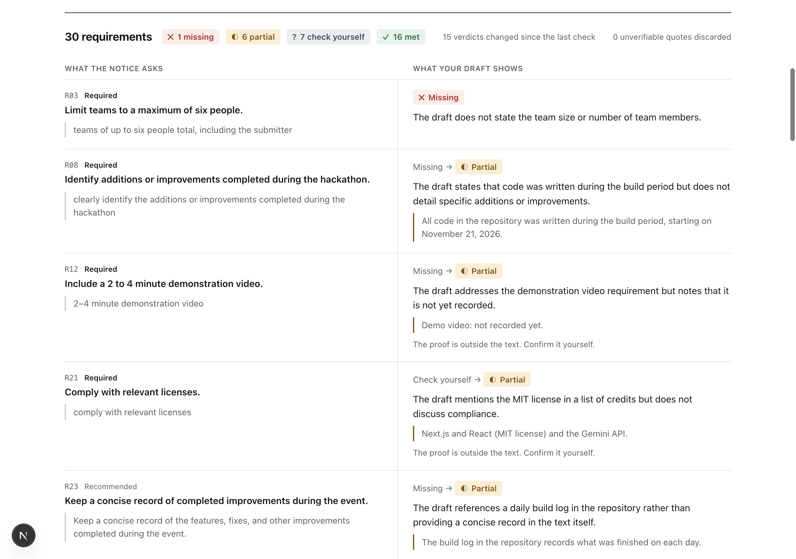

<!--
ReqLens — Devpost submission text, draft v2 (written 2026-11-26, no model call made for it).
Changes from v1: cut from about 2,700 to about 1,400 words; detailed experiments moved to docs/evaluation-details.md;
claims narrowed after review (REVIEW_writeup_v1_gpt.md). HTML comments are source notes: delete before pasting.
Open items are marked [TODO: ...]. No number is new: all were re-read for v1 from the files named there.
-->

# Devpost fields

**Project name:** ReqLens

**Tagline (short pitch):** Paste the rules and your draft: each requirement it finds, next to the sentence in your draft that answers it.

**Built With:** next.js, react, typescript, node.js, gemini-api, vercel

**Try it out links:**
- Live site: https://reqlens-two.vercel.app (press "Try a sample": no key, no account, no model call)
- Code: https://github.com/coo001/reqlens
- Test results, as generated: https://github.com/coo001/reqlens/blob/main/eval/results.md

**Video:** [TODO: YouTube link after upload]

---

# Project description ("About the project" field, paste from here)

**ReqLens compares a draft with the rules it has to follow.** You paste a notice (hackathon rules, a contest call, a scholarship posting) and your draft. It lists the requirements it finds, each with its source sentence, next to the sentence in your draft that answers it, or says it found none. It is a first-pass aid: it misses some requirements and some verdicts are wrong (numbers below).

Numbers come from [`eval/results.md`](https://github.com/coo001/reqlens/blob/main/eval/results.md), which a script generates from saved model responses. The full experiments are in [`docs/evaluation-details.md`](https://github.com/coo001/reqlens/blob/main/docs/evaluation-details.md).

## 1. Who is your project for, and why would they use it?

**Intended user:** a student entering a hackathon, contest or scholarship alone, a day or two before the deadline, with a draft in hand.

**Evidence [V1]:** we did not interview or observe users. Public material shows only the size of the task:

- This challenge's rules and resources pages are 3,257 words. The "Getting started" section is 205 words and states 4 of the 17 required items in our answer key.
- In the gallery of this organizer's previous hackathon, a script found no embedded video on 18 of 104 project pages and no code link on 34 ([data](https://github.com/coo001/reqlens/blob/main/docs/gallery_tally.tsv)), not checked by hand or against that event's rules.

**A realistic use [V1]:** we pasted this challenge's rules and our own early description. 9 rows came back Missing, among them the video and disclosing existing work. A revised draft, written before we saw that, came back with 1.

**Compared with what people do now [V2]** (small, exploratory)

| Existing way | Result |
|---|---|
| Read the organizer's short summary | States 4 of 17 required items here, 10 of 17 for an essay contest |
| Search for "must", "required", "should" (code) | Found 51 of 92 required items over 5 notices (55.4%). ReqLens: 80 of 92 (87.0%) |
| Ask a chatbot once (same model, 3 pairs) | Found all required items in all 3. ReqLens: 22 of 22 and 11 of 12 on the same two notices |

ReqLens did not find more requirements than a chatbot, and we did not measure time saved. What differs: code checks that each quote on screen is word for word in your text (that it exists, not that it is the right sentence), requirements text cannot prove get no verdict, and a re-check marks each changed verdict. In the one pair with a paragraph removed, the chatbot answered "MET" where ReqLens showed Partial.

## 2. What did your team build or improve during the hackathon?

A new project. The first commit is from Nov 21, after the build period opened.

- **Built during the event:** the web app, the code checks in section 3, record and replay of model responses, the scorer and 20 unit tests.
- **Prepared before (no code):** snapshots of 5 public notices, an answer key of 145 requirements, 8 made-up drafts (2 more added on Nov 22).
- **Third-party:** Next.js, React, the Gemini API (free tier), Vercel. No template or starter kit.

## 3. How did your team use AI?

### AI in the finished project

Gemini (`gemini-3.5-flash`) is called twice per check. The rest is code.

| Step | Done by | What happens |
|---|---|---|
| 1. Extract | Gemini | Each requirement with a quote from the notice |
| 2. Quote Lock | Code | Keeps a quote only if it is in the notice word for word |
| 3. Compare | Gemini | One verdict per requirement, with a quote from the draft |
| 4. Counted | Code | Counts the words for a word limit and sets the verdict |
| 5. Check yourself | Code | No verdict for what text cannot prove (age, enrollment, deadlines) |

**Model choice [A1]:** a free-tier model, because the intended user is a student. On 2 notices the default found 22 of 22 and 11 of 12 required items (24 s, 13 s); the lighter `gemini-3.5-flash-lite` found 21 of 22 and 11 of 12 (4 s, 2 s). We kept the default because a missed requirement is the costly error. Two notices cannot settle this.

**Design choices [A2]**

- **Quote Lock:** 1 of 112 extracted items had a quote that is not in the notice and was discarded. A small effect, and it does not show that a quote represents the requirement.
- **Counted:** with the code count, word-limit rows without a correct verdict went from 4 of 4 to 0 of 4.
- **Stricter comparison prompt:** planted gaps shown, 1 of 6 to 4 of 6.

**Quality check [A3]:** 5 notices, an answer key of 145 requirements (92 required), 10 drafts with 8 planted gaps, one run each, scored by code. Prompts were adjusted on 8 of the 10 drafts.

| Check | Result |
|---|---|
| Required items found | 80 of 92 (87.0%) |
| Planted gaps shown as Missing or Partial | 4 of 6. On the 2 gaps the prompt was not written against: 0 of 2 |
| Rows flagged on 2 complete drafts | 2 of 30 and 2 of 14, all wrong |

Two AI models from different companies wrote the answer key. **No human verified it.**

- **Trust:** that a quoted sentence is in your text, and word-limit verdicts.
- **Use as a pointer:** Missing and Partial rows. Some are wrong.
- **Do not trust:** a Met row as proof. 2 of 6 planted gaps were shown as Met. Rubric lines are covered poorly: 22 of 52 answer-key items listed for this challenge.

### AI used during development [A4]

> **No human reviewed the code.** The code, prompts, tests and this description were written by an AI coding agent (Claude). The checks below are automated (a script or the same AI, against values fixed in advance), not human review.

| AI output | Automated check | Found | Decision |
|---|---|---|---|
| Word-counting code | A separate script's counts for 8 drafts | All equal | Kept |
| Comparison prompt v1 | 6 planted gaps | 1 of 6: a passing mention accepted as Met | Revised |
| Comparison prompt v3 | The same 6 and 2 held-out drafts | 3 of 6, slower | Rejected |

## 4. How can people access and use the project, and what results does it achieve?

**Access [V3]:** https://reqlens-two.vercel.app needs a browser and two pieces of text: free, no account, no install. The input screen says the text goes to Google's Gemini API. "Try a sample" replays saved responses; live checks share a free-tier key with a daily cap. To run it yourself: `npm install`, a free Gemini key in `.env.local`, `npm run dev` (Node 20+).

**Main task [R1]:** paste the notice and the draft, press **Check my draft**, read the rows, edit the draft, press **Re-check draft**. The video shows this on the product's own screens. **Every app scene in the video replays saved Gemini responses; none is a live call.** Each is labelled "Recorded" on screen.

**Cases [R2]:** none fully met its pass condition.

| Case | Pass condition | Result | Passed |
|---|---|---|---|
| Ordinary 1: hackathon rules + complete draft | All required items listed, nothing flagged | 22 of 22 listed, but 2 of 30 rows wrongly shown as Partial | No |
| Ordinary 2: scholarship notice + essay | All required items listed, word limit counted, nothing else flagged | 11 of 12 listed. A 537-word essay shown as over the 500 limit. 2 of 14 rows wrongly flagged | No |
| Repeat: ordinary 1, three runs | Same rows and verdicts | 22 of 22 required items each time, but 30, 22 and 23 rows | No |
| Harder: this challenge's rules + our own description | Required items listed, gaps in the early draft flagged | 15 of 17 listed. Early draft 9 Missing, revised 1. Two Met verdicts too generous, one false Missing | Partly |

**Design [D1–D4]**

- **D1:** one main button; results open with a summary line, Missing rows first.
- **D2:** the four verdicts (Missing, Partial, Check yourself, Met) keep the same labels and colours on every row and in the summary; a failure message uses the Missing tint. [Result](https://github.com/coo001/reqlens/blob/main/docs/screens/hard1_recheck.png), [failure](https://github.com/coo001/reqlens/blob/main/docs/screens/r3_input_failed_live.png), [recovered](https://github.com/coo001/reqlens/blob/main/docs/screens/r3_input_recovered_live.png).
- **D3:** Re-check makes one model call instead of two and keeps the pasted text. Above 15 requirements the Met rows fold away ([closed](https://github.com/coo001/reqlens/blob/main/docs/screens/hard1_fold_closed.png), [open](https://github.com/coo001/reqlens/blob/main/docs/screens/hard1_fold_open.png)).
- **D4:** each row puts the rule's sentence, the verdict and your sentence side by side. A re-checked row shows its earlier verdict ("Missing → Partial").

## 5. What are the current limitations, and what happens when something goes wrong?

**When something goes wrong [R3]** (both recovered with live calls)

| Failure | What the app did | What was kept |
|---|---|---|
| Service: model overloaded during the comparison (injected with a test switch) | Retried once, then stopped and said the requirement list is kept. A second press ran only the comparison ([recovered](https://github.com/coo001/reqlens/blob/main/docs/screens/r3_service_recovered_live.png)) | Both texts and the 15 requirements found |
| Input: a text with no requirements pasted as the notice | "No requirements were found in that text." With the real notice pasted, the check ran to a result | The draft |

**Limitations**

- **Live calls often fail.** On the recording day 1 of 7 answered (76 s). When the free-tier provider is overloaded, only the recorded samples work.
- **Results change between runs.** In the re-check in the video, 3 rows the edit did not address changed verdict.
- English pasted text only; no PDF or image input. It does not predict judging.
- Nothing is mocked. Results are labelled "Recorded" or "Live run".

---

# YouTube

**Title:** ReqLens: compare your draft with the rules, requirement by requirement (Global AI Builder's Challenge)

**Description:**

ReqLens takes a notice (hackathon rules, a contest call, a scholarship posting) and your draft. It lists the requirements it finds, each with the sentence it comes from, and shows next to it the sentence in your draft that answers it, or that it found none.

Every app scene in this video replays saved Gemini responses and is labelled "Recorded" on screen. No scene is a live call: the model was overloaded on the recording day. Captions only, no narration.

In this video:
0:07 What it does
0:13 Paste the rules and a draft, check
0:30 Reading a row: rule sentence, verdict, draft sentence
0:50 Add the missing paragraph and re-check
1:23 A harder case: this hackathon's own rules against our own early description
2:00 When the model is overloaded

Try it: https://reqlens-two.vercel.app
Code and test results: https://github.com/coo001/reqlens

Built for the Global AI Builder's Challenge (Refactor The World), Nov 21 to 28, 2026.
<!-- Chapter times are from docs/video/demo_v1.srt; re-read from the final cut before upload. YouTube chapters need a 0:00 entry. -->

---

# Pre-submit checklist (for us, not for pasting)

- [ ] Video uploaded to YouTube, embedding on, plays signed out, 2 to 4 minutes (v1 is 2:39). Link put in the Video field.
- [ ] `docs/evaluation-details.md` and `docs/gallery_tally.tsv` pushed: the description links to both, and the links are dead until then.
- [ ] If a live scene gets recorded, rewrite the R1 line, the first limitation and the YouTube description.
- [ ] HTML comments removed from the pasted text.
- [ ] Team roster on Devpost: one member. Participant Contact Google Form filled in by the participant.
- [ ] "No human reviewed the code" and "No human verified the answer key" confirmed by the participant as still true on the day of submission. If the participant did review something, say exactly what.
- [ ] Screenshots: `sample_gap_1440.png` is outdated and `r3_service_failed_live.png` is a broken crop; neither is linked.
