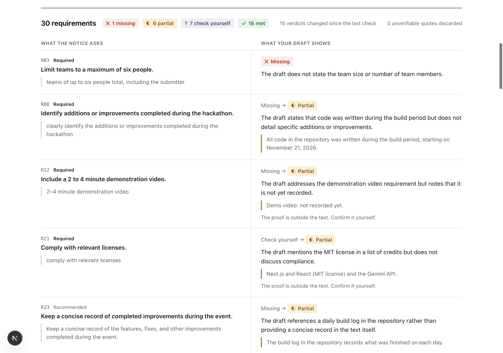

# Review input: ReqLens Devpost write-up v2 (2026-11-26)

리뷰어에게: 아래 A는 제출할 글(영어, 붙여 넣을 그대로)이고, B는 이 대회의 제출 요건·심사 기준(공식 원문 인용과 한국어 요약), C는 같은 주최 직전 회차 수상작 요약이다. 기획 메모는 일부러 넣지 않았다.
해 줄 일:
1. B의 체크 25개(V1~D4)를 하나씩, 심사위원처럼 "이 글과 영상 설명만 보고 이 체크를 줄 수 있는가"로 예/아니오와 근거 한 줄을 적는다. 섹션별 점수와 합계(100점)를 낸다. 심사위원은 앱을 실행하지 않는다.
2. C의 수상작(특히 상위 3개)보다 약한 점을 적는다.
3. 고칠 것 3개를 중요한 순서로 적는다.
4. 과장·근거 없는 문장, 숫자가 서로 안 맞는 곳, AI가 쓴 티가 나는 문장을 짚는다.
통과 기준: 80% 이상, 7/10 미만 항목 없음, 수상작과 같은 수준 이상.
참고:
- 영상은 아직 올리지 않았다(편집본 v1, 2분 39초, 모든 앱 장면이 저장된 응답 재생, 자막만). 글 속 [TODO]는 제출 전 채울 자리다. 영상이 올라간 상태를 가정한 점수와 지금 상태의 점수를 따로 적어 달라.
- 설명문 본문은 약 1,500단어(표 포함)다. 본문에서 뺀 세부 실험은 저장소의 docs/evaluation-details.md로 옮겼고 본문에서 링크한다(리뷰 입력에는 넣지 않았다).
- 사용자 인터뷰·관찰은 실제로 하지 않았다. 없는 근거를 만들어 넣으라는 제안은 반영할 수 없다.
- 앱 기능과 시험 결과는 이 글을 쓰는 동안 바뀌지 않았다.

---

# A. 제출 글 (v2)

# Devpost fields

**Project name:** ReqLens

**Tagline (short pitch):** Paste the rules and your draft: each requirement it finds, next to the sentence in your draft that answers it.

**Built With:** next.js, react, typescript, node.js, gemini-api, vercel

**Try it out links:**
- Live site: https://reqlens-two.vercel.app (press "Try a sample": no key, no account, no model call)
- Code: https://github.com/coo001/reqlens
- Test results, as generated: https://github.com/coo001/reqlens/blob/main/eval/results.md

**Video:** [TODO: YouTube link after upload]

---

# Project description ("About the project" field, paste from here)

**ReqLens compares a draft with the rules it has to follow.** You paste a notice (hackathon rules, a contest call, a scholarship posting) and your draft. It lists the requirements it finds, each with its source sentence, next to the sentence in your draft that answers it, or says it found none. It is a first-pass aid: it misses some requirements and some verdicts are wrong (numbers below).

Numbers come from [`eval/results.md`](https://github.com/coo001/reqlens/blob/main/eval/results.md), which a script generates from saved model responses. The full experiments are in [`docs/evaluation-details.md`](https://github.com/coo001/reqlens/blob/main/docs/evaluation-details.md).

## 1. Who is your project for, and why would they use it?

**Intended user:** a student entering a hackathon, contest or scholarship alone, a day or two before the deadline, with a draft in hand.

**Evidence [V1]:** we did not interview or observe users. Public material shows only the size of the task:

- This challenge's rules and resources pages are 3,257 words. The "Getting started" section is 205 words and states 4 of the 17 required items in our answer key.
- In the gallery of this organizer's previous hackathon, a script found no embedded video on 18 of 104 project pages and no code link on 34 ([data](https://github.com/coo001/reqlens/blob/main/docs/gallery_tally.tsv)), not checked by hand or against that event's rules.

**A realistic use [V1]:** we pasted this challenge's rules and our own early description. 9 rows came back Missing, among them the video and disclosing existing work. A revised draft, written before we saw that, came back with 1.

**Compared with what people do now [V2]** (small, exploratory)

| Existing way | Result |
|---|---|
| Read the organizer's short summary | States 4 of 17 required items here, 10 of 17 for an essay contest |
| Search for "must", "required", "should" (code) | Found 51 of 92 required items over 5 notices (55.4%). ReqLens: 80 of 92 (87.0%) |
| Ask a chatbot once (same model, 3 pairs) | Found all required items in all 3. ReqLens: 22 of 22 and 11 of 12 on the same two notices |

ReqLens did not find more requirements than a chatbot, and we did not measure time saved. What differs: code checks that each quote on screen is word for word in your text (that it exists, not that it is the right sentence), requirements text cannot prove get no verdict, and a re-check marks each changed verdict. In the one pair with a paragraph removed, the chatbot answered "MET" where ReqLens showed Partial.

## 2. What did your team build or improve during the hackathon?

A new project. The first commit is from Nov 21, after the build period opened.

- **Built during the event:** the web app, the code checks in section 3, record and replay of model responses, the scorer and 20 unit tests.
- **Prepared before (no code):** snapshots of 5 public notices, an answer key of 145 requirements, 8 made-up drafts (2 more added on Nov 22).
- **Third-party:** Next.js, React, the Gemini API (free tier), Vercel. No template or starter kit.

## 3. How did your team use AI?

### AI in the finished project

Gemini (`gemini-3.5-flash`) is called twice per check. The rest is code.

| Step | Done by | What happens |
|---|---|---|
| 1. Extract | Gemini | Each requirement with a quote from the notice |
| 2. Quote Lock | Code | Keeps a quote only if it is in the notice word for word |
| 3. Compare | Gemini | One verdict per requirement, with a quote from the draft |
| 4. Counted | Code | Counts the words for a word limit and sets the verdict |
| 5. Check yourself | Code | No verdict for what text cannot prove (age, enrollment, deadlines) |

**Model choice [A1]:** a free-tier model, because the intended user is a student. On 2 notices the default found 22 of 22 and 11 of 12 required items (24 s, 13 s); the lighter `gemini-3.5-flash-lite` found 21 of 22 and 11 of 12 (4 s, 2 s). We kept the default because a missed requirement is the costly error. Two notices cannot settle this.

**Design choices [A2]**

- **Quote Lock:** 1 of 112 extracted items had a quote that is not in the notice and was discarded. A small effect, and it does not show that a quote represents the requirement.
- **Counted:** with the code count, word-limit rows without a correct verdict went from 4 of 4 to 0 of 4.
- **Stricter comparison prompt:** planted gaps shown, 1 of 6 to 4 of 6.

**Quality check [A3]:** 5 notices, an answer key of 145 requirements (92 required), 10 drafts with 8 planted gaps, one run each, scored by code. Prompts were adjusted on 8 of the 10 drafts.

| Check | Result |
|---|---|
| Required items found | 80 of 92 (87.0%) |
| Planted gaps shown as Missing or Partial | 4 of 6. On the 2 gaps the prompt was not written against: 0 of 2 |
| Rows flagged on 2 complete drafts | 2 of 30 and 2 of 14, all wrong |

Two AI models from different companies wrote the answer key. **No human verified it.**

- **Trust:** that a quoted sentence is in your text, and word-limit verdicts.
- **Use as a pointer:** Missing and Partial rows. Some are wrong.
- **Do not trust:** a Met row as proof. 2 of 6 planted gaps were shown as Met. Rubric lines are covered poorly: 22 of 52 answer-key items listed for this challenge.

### AI used during development [A4]

> **No human reviewed the code.** The code, prompts, tests and this description were written by an AI coding agent (Claude). The checks below are automated (a script or the same AI, against values fixed in advance), not human review.

| AI output | Automated check | Found | Decision |
|---|---|---|---|
| Word-counting code | A separate script's counts for 8 drafts | All equal | Kept |
| Comparison prompt v1 | 6 planted gaps | 1 of 6: a passing mention accepted as Met | Revised |
| Comparison prompt v3 | The same 6 and 2 held-out drafts | 3 of 6, slower | Rejected |

## 4. How can people access and use the project, and what results does it achieve?

**Access [V3]:** https://reqlens-two.vercel.app needs a browser and two pieces of text: free, no account, no install. The input screen says the text goes to Google's Gemini API. "Try a sample" replays saved responses; live checks share a free-tier key with a daily cap. To run it yourself: `npm install`, a free Gemini key in `.env.local`, `npm run dev` (Node 20+).

**Main task [R1]:** paste the notice and the draft, press **Check my draft**, read the rows, edit the draft, press **Re-check draft**. The video shows this on the product's own screens. **Every app scene in the video replays saved Gemini responses; none is a live call.** Each is labelled "Recorded" on screen.

**Cases [R2]:** none fully met its pass condition.

| Case | Pass condition | Result | Passed |
|---|---|---|---|
| Ordinary 1: hackathon rules + complete draft | All required items listed, nothing flagged | 22 of 22 listed, but 2 of 30 rows wrongly shown as Partial | No |
| Ordinary 2: scholarship notice + essay | All required items listed, word limit counted, nothing else flagged | 11 of 12 listed. A 537-word essay shown as over the 500 limit. 2 of 14 rows wrongly flagged | No |
| Repeat: ordinary 1, three runs | Same rows and verdicts | 22 of 22 required items each time, but 30, 22 and 23 rows | No |
| Harder: this challenge's rules + our own description | Required items listed, gaps in the early draft flagged | 15 of 17 listed. Early draft 9 Missing, revised 1. Two Met verdicts too generous, one false Missing | Partly |

**Design [D1–D4]**

- **D1:** one main button; results open with a summary line, Missing rows first.
- **D2:** the four verdicts (Missing, Partial, Check yourself, Met) keep the same labels and colours on every row and in the summary; a failure message uses the Missing tint. [Result](https://github.com/coo001/reqlens/blob/main/docs/screens/hard1_recheck.png), [failure](https://github.com/coo001/reqlens/blob/main/docs/screens/r3_input_failed_live.png), [recovered](https://github.com/coo001/reqlens/blob/main/docs/screens/r3_input_recovered_live.png).
- **D3:** Re-check makes one model call instead of two and keeps the pasted text. Above 15 requirements the Met rows fold away ([closed](https://github.com/coo001/reqlens/blob/main/docs/screens/hard1_fold_closed.png), [open](https://github.com/coo001/reqlens/blob/main/docs/screens/hard1_fold_open.png)).
- **D4:** each row puts the rule's sentence, the verdict and your sentence side by side. A re-checked row shows its earlier verdict ("Missing → Partial").

## 5. What are the current limitations, and what happens when something goes wrong?

**When something goes wrong [R3]** (both recovered with live calls)

| Failure | What the app did | What was kept |
|---|---|---|
| Service: model overloaded during the comparison (injected with a test switch) | Retried once, then stopped and said the requirement list is kept. A second press ran only the comparison ([recovered](https://github.com/coo001/reqlens/blob/main/docs/screens/r3_service_recovered_live.png)) | Both texts and the 15 requirements found |
| Input: a text with no requirements pasted as the notice | "No requirements were found in that text." With the real notice pasted, the check ran to a result | The draft |

**Limitations**

- **Live calls often fail.** On the recording day 1 of 7 answered (76 s). When the free-tier provider is overloaded, only the recorded samples work.
- **Results change between runs.** In the re-check in the video, 3 rows the edit did not address changed verdict.
- English pasted text only; no PDF or image input. It does not predict judging.
- Nothing is mocked. Results are labelled "Recorded" or "Live run".

---

# YouTube

**Title:** ReqLens: compare your draft with the rules, requirement by requirement (Global AI Builder's Challenge)

**Description:**

ReqLens takes a notice (hackathon rules, a contest call, a scholarship posting) and your draft. It lists the requirements it finds, each with the sentence it comes from, and shows next to it the sentence in your draft that answers it, or that it found none.

Every app scene in this video replays saved Gemini responses and is labelled "Recorded" on screen. No scene is a live call: the model was overloaded on the recording day. Captions only, no narration.

In this video:
0:07 What it does
0:13 Paste the rules and a draft, check
0:30 Reading a row: rule sentence, verdict, draft sentence
0:50 Add the missing paragraph and re-check
1:23 A harder case: this hackathon's own rules against our own early description
2:00 When the model is overloaded

Try it: https://reqlens-two.vercel.app
Code and test results: https://github.com/coo001/reqlens

Built for the Global AI Builder's Challenge (Refactor The World), Nov 21 to 28, 2026.

---

# B. 대회 제출 요건과 심사 기준 (공식 페이지에서 옮김, 확인 2026-11-16)

## 3. 제출물

> "Each submission must include a project description, a 2–4 minute demonstration video, public GitHub access to all project code, the complete team roster, a development disclosure, and an AI disclosure." (Rules)

| 항목 | 요구 | 원문 |
|---|---|---|
| 영상 | **2~4분**, YouTube 또는 Vimeo, 임베드 허용, 비로그인 재생 확인 | "Submit a 2–4 minute video. A straightforward screen recording, hardware recording, or another clear demonstration of the actual work is sufficient." / "Upload the video to YouTube or Vimeo, enable embedding, and check that the video plays for someone who is not signed into your account." |
| 저장소 | **공개 GitHub**, 전체 코드, 설치 방법, 외부 의존성·서비스 명시. 키·비밀번호·개인정보 금지 | "A public GitHub repository containing all code developed for the project, with setup instructions and relevant third-party dependencies or services identified. Never publish passwords, API keys, or private data." |
| 설명문 | Devpost 프로젝트 설명에서 **5개 질문**에 답한다(아래) | "A Devpost project description answering the five questions below." |
| 팀 명단 | 공개 명단, 최대 6명, 솔로 가능 | "Teams may have up to six members total, including the submitter. Solo participation is welcome." |
| 라이브 데모 | **선택** (Momen 사용 시에만 필수) | "Include a live link if available; a hosted application is optional unless you built your project with Momen." |
| 개인 폼 | **참가자마다** Google Form에 수상·수료증용 이름과 연락 메일 제출 | "Each participant must submit their award or certificate name and contact email privately through the Participant Contact & Sponsor Opt-In form. Each team member fills out their own form. Sponsor opt-ins are optional." |

폼 주소: https://docs.google.com/forms/d/e/1FAIpQLSfMvBawsnQSa3WbX7ufHlLOCLcOqA0aF-LeaeS-iEPCdujM4g/viewform

### 설명문 5개 질문 (원문 제목)

1. **Who is your project for, and why would they use it?** — 사용자·사용 상황, 필요의 근거(예시나 출처), 현재 방식 대비 이점.
2. **What did your team build or improve during the hackathon?** — 신규/기존 여부, 기존이면 시작점과 대회 중 변경분, 제3자 도구·템플릿과 자기 기여 구분.
3. **How did your team use AI?** — "Describe AI in the finished project separately from AI used during development." 해당 없으면 없다고 명시.
4. **How can people access and use the project, and what results does it achieve?** — 접근 방법·비용·계정, 주 작업과 성공 조건, R2용 사례 표.
5. **What are the current limitations, and what happens when something goes wrong?** — 미완성·시뮬레이션·목업 표시, 실패 처리 증거.

> "Short paragraphs, bullet points, screenshots, and small tables are welcome. You may link to relevant README sections or other supporting evidence. Use rubric labels, such as A2 or R2, when useful."

### 영상에 담을 것 (원문 5항)

> "Who is the project for? … What does the actual project do? Spend most of the video showing the main task from its starting point to its result. … Where does AI contribute? … What did the team create during the event? … What limitations affect the demonstration?"

> "Editing is allowed. Label accelerated footage and skipped waiting periods. Slides may support the explanation, but the video must show the actual submitted work."

> "The video does not need to cover every scoring checkbox. Put detailed AI comparisons, implementation explanations, test summaries, and design comparisons in the description or clearly linked supporting material."

## 4. 심사 방식과 배점

| Section | Maximum points |
|---|---|
| Problem Value & Practicality | 20 |
| AI Integration & Development | 30 |
| Functionality & Reliability | 30 |
| Design Quality & User Experience | 20 |
| Total | 100 |

핵심 원문:

> "The full rubric contains 25 checks … Each satisfied checkbox earns its printed whole-number points."
> "Each checkbox earns its printed points when the submission demonstrates the requirement; otherwise award zero."
> "Judges normally score the demo and project description, with supporting evidence where useful. They do not normally install or run submissions."
> "Simply supplying those items, stating a test goal, or recruiting an outside tester earns no separate quality bonus. A public deployment and an outside tester are optional."
> "Judges score assigned sections. Multiple judges' totals are averaged within each section, then the four section averages are added. Scores of 95 or above receive a second independent review under the same criteria."

→ **부분 점수가 없는 체크박스 채점이고, 심사위원은 실행하지 않고 영상과 설명문만 본다.** 점수는 "증거를 설명문에 넣었는가"로 갈린다.

### 전체 체크리스트 (Resources 원문 요약, 점수는 원문 그대로)

**V. Problem Value & Practicality — 20**

| 라벨 | 체크 | 점 |
|---|---|---|
| V1 | 대상 사용자의 구체적 필요를 뒷받침하는 믿을 만한 증거(관찰·사용자 말·직접 경험·출판 자료·구체 예) | 4 |
| V1 | 현실적 사용 예가 주 기능과 그 필요를 잇는다 | 4 |
| V2 | 같은 목표의 기존 도구·수작업·해결책 부재와 비교하고, 비교 사실의 출처를 밝힌다 | 3 |
| V2 | 비교 증거가 구체적 이점을 뒷받침한다(못 하던 일 가능, 불편 제거, 시간·자원 절감) | 5 |
| V3 | 대상 사용자가 가진 장비·정보·권한·운영 자원으로 실제 쓸 수 있다 | 4 |

**A. AI Integration & Development — 30** (A1~A3 = 완성품 속 AI 24점, A4 = 개발 중 AI 6점)

| 라벨 | 체크 | 점 |
|---|---|---|
| A1 | 그 AI 모델·도구·방법이 이 일에 맞는 이유(인식 품질·속도·비용·자원·온디바이스 등) | 3 |
| A1 | 그 이유를 뒷받침하는 비교 정보나 테스트 증거(공식 가격·문서화된 성능·자체 테스트 가능) | 3 |
| A2 | 프로젝트 고유 문제를 푸는 **구현된** AI 설계 선택이 있다 | 4 |
| A2 | 그 선택이 목표에 기여함을 보이는 증거(작업 예·비교·테스트 결과) | 6 |
| A3 | 명확한 기준에 대한 AI 품질 점검 — **실제 결과와 점검 방법** 포함 | 4 |
| A3 | 평가 결과나 문서화된 한계로 "언제 믿을 수 있고 없는지" 설명 | 4 |
| A4 | 개발 중 AI 기여를 사람이 점검한 증거(생성 코드를 알려진 결과와 대조 등) | 3 |
| A4 | 점검이 무엇을 찾았고, 유지·수정·기각 결정과 그 근거 | 3 |

> "Simply reporting AI use earns no points." / "A generally working feature alone does not establish why a specific AI design choice helps."

**R. Functionality & Reliability — 30**

| 라벨 | 체크 | 점 |
|---|---|---|
| R1 | 실제 제출물이 시작 동작부터 최종 출력까지 주 과정을 완주한다. 데모가 전 과정을 보여 주고 수동 단계·특수 조건을 밝힌다 | 6 |
| R2 | 평범한 사례 1이 요구 조건을 충족 | 3 |
| R2 | 다른 정보·상황의 평범한 사례 2 | 3 |
| R2 | 평범한 사례의 반복(또는 결과 재검)도 충족 | 4 |
| R2 | 주장 범위 안의 더 어려운 사례 충족 | 6 |
| R3 | 실패·미지원 상황 1을 감지하고 적절히 처리(수정·재시도·백업·경고·명확한 종료), 앞선 유효 작업 보존 | 4 |
| R3 | **원인이 다른** 실패 2도 같은 기준으로 처리 | 4 |

> "For every case, make clear what should happen and show what actually happened. A concise table with supporting screenshots, clips, or results is enough; four separate videos are not required."
> "Unreadable data and an unavailable service are different causes; two unreadable files usually represent the same cause."

**D. Design Quality & User Experience — 20**

| 라벨 | 체크 | 점 |
|---|---|---|
| D1 | 주 동작과 가장 중요한 정보가 주 경험 전체에서 분명히 도드라진다 | 4 |
| D2 | 반복 요소가 일관된 디자인(글자·간격·색·컨트롤·라벨, 오류·완료 화면 포함) | 4 |
| D3 | 구체적 사용자 수고를 없애는 디자인 선택이 시연된다(반복 입력·불필요한 이동·자주 쓰는 동작 찾기) | 4 |
| D4 | 필요한 정보를 찾을 수 있게 묶고 라벨링·정렬 | 3 |
| D4 | 유용한 관계를 직접 보이게 한다(옵션 간 차이, 변경의 효과, 결론과 근거의 연결) | 5 |

> "Judge the project's design, not video production."

### 채점 운영

> "Each judge scores only the assigned section: 5 checks for V, 8 for A, 7 for R, or 5 for D. … If a checkbox requires unfamiliar technical knowledge, leave the checkbox pending and request a technical review instead of guessing."
> "Overall scoring adds no separate points for team size, spending, video production, or presentation confidence."

심사위원 8명: Ahmad Abuizzah(주최 창립자), Ismail Bashandy, Shayan Hoque, Adam Ali·Rayyan Hashmi·Morgan Spencer(MeltingPot 공동창업자), Takoua El Bejaoui, Muhammad Abdullah Nazeer.

## 5. AI 사용 규정

> "AI integration is encouraged but is not mandatory. AI-assisted development is permitted and can earn credit under the published rubric. Teams must accurately disclose the use of AI and distinguish their contributions from pre-existing tools, services, and other work." (Rules)

> "AI is encouraged, not mandatory. A1–A3 provide up to 24 points for AI used by the finished project. A4 provides up to 6 points for reviewed AI-assisted development. A project using no AI can earn up to 70 overall points; a project using AI only during development can earn up to 76." (Resources)

> "No particular AI provider, prompts, input-preparation method, custom training, paid tool, or number of AI components is required." (Resources)

- AI 코딩 도구 사용은 허용이고, **사람이 점검한 기록을 남기면 6점**이다(A4). 단순 "썼다"는 0점.
- **AI 공개(disclosure)는 필수 제출 요건**이다 — 완성품 속 AI와 개발 중 AI를 나눠 적는다.
- 카테고리 상 앞의 15개(Best AI Agent ~ Best AI Engineering)는 완성품에 AI가 들어가야 한다. "AI-assisted development alone does not qualify a project for those awards."

## 6. 해킹 기간 전 코드 작성 — 허용(공개 조건)

> "New projects and improvements to existing projects are permitted. Teams must disclose any existing work and clearly identify the additions or improvements completed during the hackathon. Judges will evaluate the finished project while focusing on the event's contributions." (Rules)

> "If you are improving an existing project, document the starting point before making changes. Keep a concise record of the features, fixes, and other improvements completed during the event." (Resources)

- 기간 전 코드가 금지되지는 않는다. 다만 **시작점을 공개해야 하고, 심사는 기간 중 기여에 초점**을 둔다.
- 권장: 코드는 11/21 17:00 KST 이후 새 저장소에서 시작해 "new project"로 신고한다(설명 부담이 없고 Originality 상 문구 "original contribution made during this event"에도 유리). 기간 전에는 기획·자료 조사·평가용 데이터 준비·API 키 발급만 한다. 평가용 데이터를 미리 만들면 그것도 "기존 작업"으로 적는다.

---

# C. 같은 주최 직전 회차(ImpactHack 2026) 수상작 요약

## 2. 수상작 14개 전수

글 길이는 Devpost 본문 단어 수, 영상은 YouTube 실측 길이(Vimeo는 길이 미확인).

| 작품 | 수상 | 팀 | 글 | 영상 | 배포·저장소 | 스택 |
|---|---|---|---|---|---|---|
| [Bolo Doctor](https://devpost.com/software/bolo-doctor-2ebh19) | **1위** + Social Impact | 1 | 89단어, 이미지 0 | 2:22 | GitHub(MIT, exe 릴리스), 배포 없음 | Electron, Groq, Sarvam AI |
| [ModelScope](https://devpost.com/software/modelscope-y1mr73) | **2위** + Data & Analytics | 1 | 714 | 2:02 | Vercel + GitHub | Next.js, Three.js, Gemini, Vitest |
| [FinePrint](https://devpost.com/software/fineprint-ldb15v) | **3위** + Productivity & Automation | 1 | 671 | 2:49 | Render + GitHub | FastAPI, Gemini |
| [SenseMap](https://devpost.com/software/sensemap-ga4tqk) | 4위 + People's Choice | 4 | 366 | Vimeo | 배포 + GitHub | Next.js, Gemini, SerpAPI, Supabase |
| [KitBridge](https://devpost.com/software/kitbridge-5tnpj2) | 5위 + Technical | 1 | 698 | 2:06 | Vercel + GitHub(MIT) | React, HiGHS(WASM) — **AI 없음** |
| [ClassVault Organizer](https://devpost.com/software/classvault-organizer) | 6위 + Education | 1 | 605 | 3:06 | Cloudflare Pages + GitHub | HTML/JS, Llama |
| [Nu Age](https://devpost.com/software/nu-age-4835v2) | 7위 + Design & UX | 1 | 1,623 | Vimeo | 자체 도메인 + GitHub | Flet, FastAPI |
| [ResiliRoute](https://devpost.com/software/resiliroute) | 8위 + Most Innovative | 1 | 877 | 3:50 | GitHub만 | TypeScript, OpenStreetMap |
| [LiverLoop](https://devpost.com/software/liverloop) | 9위 + Judges' Choice | 1 | 664 | 3:53 | Vercel + GitHub | React, Groq |
| [TuyDui](https://devpost.com/software/tuydui-tndom4) | 10위 | 2 | 427 | 2:14 | Vercel + GitHub | React, LLM |
| [PG-REGISTER](https://devpost.com/software/pg-register) | Best Use of AI | 4 | 653 | **5:01(규정 초과)** | GitHub만 | InsightFace, ONNX, React |
| [NeuroBridge](https://devpost.com/software/neurobridge-0d7g3n) | Accessibility | 1 | 575 | 2:53 | Vercel + GitHub | React, Gemini 2.5 Flash |
| [AgriSeed Rover](https://devpost.com/software/agriseed-rover-and-ai-prv82w) | Hardware / IoT | 1 | 977 | Vimeo | GitHub 2개 | C/C++, Gemini |
| [SafeNet](https://devpost.com/software/safenet-zuh0j9) | Demo & Presentation | 1 | 761 | Vimeo | Kaggle 노트북만 | XGBoost, Flower(연합학습) |

관찰:
- **수상 14개 중 10개가 1인 작품이다.** 종합 1·2·3위가 전부 솔로.
- 수상작은 전부 영상이 있다. 대조군 6개 중 3개(Study Masters, EcoSort AI, TeachBack-AI)는 영상이 없었고 전부 탈락.
- 종합 10위 안에서 저장소 없이 받은 작품은 없다. 라이브 배포는 10개 중 7개.
- 조회수는 14~91회다. 영상은 대중이 아니라 심사위원만 본다.

## 3. 상위 3개 실물 분석

### Bolo Doctor — 1위 + Best Social Impact
- **글이 89단어, 스크린샷 0장인데 1위다.** 영상(2:22)과 제품이 점수를 다 냈다.
- 한 문장 정의가 사용자·상황·결과를 다 담는다: "Voice-first patient notes for small clinics. Dictate in Hindi, Kannada, Hinglish, or English, get a clean structured note."
- AI 역할이 분업으로 설명된다: Sarvam이 전사(힝글리시 인식이 선택 이유), Groq이 구조화. README: "the AI never guesses a drug name, never changes a dose, and never invents a detail. Anything uncertain is flagged for the doctor to check."
- 사람 승인 단계가 제품 안에 있다: "Nothing is saved until the doctor reviews and approves it."
- 키 없이 도는 데모 버튼(녹음된 받아쓰기 재생), Windows exe 릴리스, 커밋 약 25개. 저장소 생성 2026-09-25로 대회 시작(10/1) 전 — 기존 작업 개선이 허용되고 실제로 1위를 했다.
- 배점 대응: Impact(좁고 실재하는 사용자), Use of AI(모델 선택 이유가 사용자 언어와 직결), Functionality(주 작업 하나를 끝까지).

### ModelScope — 2위 + Best Data & Analytics
- 기본 필드 뒤에 **"Responsible AI and development disclosure"와 "Limitations and privacy"를 따로 붙였다.** 이번 대회의 5개 질문 중 3·5번이 요구하는 내용과 같다.
- AI 경계 한 줄: "AI explains. The analysis engine decides." Gemini는 설정 제안과 결과 설명만 하고, 계산은 결정적 TypeScript 엔진이 한다.
- 검증 수치를 적었다: "306 passing tests with typecheck, lint and build passing". 한계를 구체적으로 적었다: "Built-in datasets are synthetic educational demonstrations, not laboratory validation."
- 개발 AI 공개: "Codex assisted engineering, debugging, research, documentation and verification. Runtime Gemini is separate from AI coding assistance." 영상은 본인 육성 내레이션.
- 커밋 약 51개, Vercel 배포.

### FinePrint — 3위 + Best Productivity & Automation
- Inspiration 첫 문장이 누구나 아는 경험이다: "Almost everyone has signed something they didn't fully read."
- **AI 실패를 코드로 막은 설계를 이름 붙여 설명했다.** Grounding Guardrail(모든 지적에 원문 그대로의 인용을 요구하고 파이썬 문자열 대조로 확인, 없으면 폐기), Skeptic(다른 에이전트를 반박하는 에이전트), 위험 점수는 "calculated by fixed rules rather than a model's guess".
- Challenges가 문제 → 해결 구조다(Hallucinations → Guardrail, Over-flagging → Skeptic).
- 에이전트 추론을 화면에 스트리밍해 AI가 하는 일이 영상에 보인다. 커밋 약 13개, Render 무료 배포.

### 참고: KitBridge(5위, AI 없음)·SenseMap(4위)
- KitBridge는 숫자 예시 하나로 가치를 증명한다: "the stock on hand packs 8 kits. One $5 pack of notebooks brings that to 12 of 16." 검증도 수치다: "We tested the solver against brute force on 96 small drives, and it matched every time." 영상은 Remotion으로 실제 화면 스크린샷을 조립했고 AI 내레이션임을 밝혔다.
- SenseMap은 글이 가장 약한데(366단어, Challenge가 "API 키 구현") 4위다. 친구의 실제 경험에서 나온 좁은 문제 + 0~100 감각 점수라는 한눈에 보이는 결과 + 4인 팀의 투표 동원(People's Choice)이 받쳤다.

## 4. 탈락작 6개와의 차이

| 작품 | 상태 | 수상작과 다른 점 |
|---|---|---|
| [Study Masters](https://devpost.com/software/study-masters) | 영상 없음, 배포 있음 | PDF→퀴즈. 같은 주제가 갤러리에 여럿(Acader, Cognita, SimuExam, KlugMind, TeachBack) |
| [Acader](https://devpost.com/software/acader-1bhz6k) | 영상·배포 있음, 저장소 링크 없음 | 노트→연습문제. 주제 중복, 차별 설계 없음 |
| [EcoSort AI](https://devpost.com/software/ecosort-ai-a8f97y) | 영상·이미지 없음 | 글 260단어, 태그 24개 나열 |
| [TeachBack-AI](https://devpost.com/software/teachback-ai-fyeo4k) | 영상·링크·이미지 전무 | 설명만 있음 |
| [BreadRelay](https://devpost.com/software/breadrelay) | 영상·배포·저장소·Playwright 다 있음 | **완성도는 수상작급인데 탈락.** AI 없음(Web Worker 최적화). 같은 유형의 KitBridge가 Technical을 가져갔다 |
| [Sponge](https://devpost.com/software/sponge-d47y9h) | 영상 있음, 글 1,627단어 | 저장소 대신 Claude 아티팩트 링크. 실행 중 AI 없음 |

읽히는 패턴:
1. **영상이 없으면 탈락.** 예외 없음.
2. **"AI 공부 도우미·웰니스 챗봇·폐기물 분류·작물 진단·계약서 분석"은 붐빈다.** 104개 중 학습 보조류만 10개 이상, 건강·웰니스류 10개 이상. Education 상은 "지저분한 과제물 정리 + 작업량 계획"으로 범위를 좁힌 ClassVault가 받았다.
3. **AI 없는 고완성도 작품은 한 자리(Technical)만 열려 있었다.** 이번엔 상한이 70~76점으로 명문화됐다.
4. 글 길이는 순위와 무관하다(89단어 1위, 1,627단어 탈락). 긴 글이 아니라 구체적 수치·예시가 있는 글이 올라갔다.

## 5. 글 구조 분석 (devpost-submission-writer 기준 대조)

스킬의 기준은 "Specific beats grand; honest beats impressive", 사용자 결과 먼저, 저장소가 뒷받침하는 주장만, 금지 문구 없음이다.

- 수상작 대부분은 Devpost 기본 7필드(Inspiration / What it does / How we built it / Challenges / Accomplishments / What we learned / What's next)를 그대로 썼다.
- 상위권 글의 공통점은 스킬 기준과 일치한다: ① 태그라인이 사용자와 결과를 말한다 ② Inspiration이 개인 경험이나 구체 장면이다(LiverLoop 할아버지 수술, SenseMap 친구, KitBridge 기부 물품 상자) ③ 숫자가 있다(8→12 키트, 96개 사례, 306 테스트) ④ AI의 한계와 사람 검토 단계를 스스로 밝힌다 ⑤ "seamless·revolutionize" 같은 문구가 없다.
- 탈락작 글은 기능 나열, 기술 태그 과다, "AI-powered platform" 류 범용 문장이 많다.

**이번 대회와의 간극:** 지난 회차 글들은 이번 체크박스 루브릭으로 채점하면 A1(선택 근거의 비교 증거), A3(평가 실측), A4(개발 AI 점검 기록), R2(사례 4건 표), R3(원인이 다른 실패 2건), V2(출처 있는 비교)를 거의 못 채운다. 가장 가까운 ModelScope도 사례 표와 비교 출처는 없다. 지난 수상작 수준의 제품에 **증거 표를 갖춘 설명문**을 붙이면 글에서 앞선다. 다만 주최가 루브릭과 5개 질문을 공개했으므로 올해 상위권은 다들 이 구조로 쓸 것으로 본다.

## 6. 수상 기준선

이 주최에서 상을 받으려면 최소한 다음이 있어야 한다. 주 작업 하나가 처음부터 끝까지 실제로 도는 제품, 그것을 2~4분 안에 화면 녹화로 보여 주는 영상(육성이나 자막 내레이션, 편집은 단순해도 된다), 공개 GitHub 저장소(커밋 13~50개 수준, 설치 방법), 가능하면 무료 호스팅 배포 링크, 스크린샷 4~10장. 문제는 넓은 사회 문제가 아니라 사용자와 상황이 한 문장으로 특정되는 좁은 문제여야 하고, AI는 "붙였다"가 아니라 무슨 일을 왜 그 모델로 하는지와 틀렸을 때 어떻게 막는지(원문 대조·사람 승인·결정적 계산과의 분리)가 설명돼야 한다. 종합 상위 3위는 여기에 검증 수치와 한계 공개가 더해졌다. 이번 대회는 채점이 체크박스로 바뀌었으므로 위 기준선에 더해 설명문에 사례 표(R2 4건, R3 2건), AI 평가 실측(A3), 모델 선택 비교(A1), 개발 AI 점검 기록(A4)이 들어가야 상위권이다. 1인 제작은 불리하지 않다.
